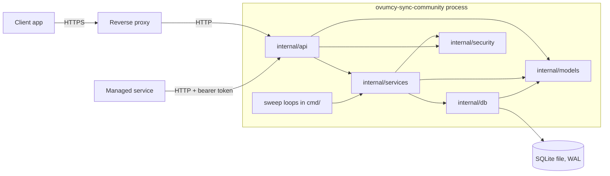

# Architecture

`ovumcy-sync-community` is a self-hosted, zero-knowledge encrypted-sync server. It stores account,
session and device metadata plus opaque ciphertext blobs. It never sees cycle dates, symptoms, notes,
recovery phrases, client master keys or decrypted payloads; those stay on the client. It is also not
an entitlement authority: premium state belongs to the separate managed service, and the community
capability response stays honest about that.

Companion documents: [auth policy and rate limits](security/auth-policy-and-rate-limits.md),
[SECURITY.md](../SECURITY.md) (test-backed claims), [self-hosting](self-hosting.md),
[backup and restore](backup-restore.md), [openapi.yaml](../openapi.yaml).

## Layers

| Layer | Path | Owns | Must not |
| --- | --- | --- | --- |
| api | `internal/api/server.go` | Transport: route registration, headers and CORS, client IP resolution, rate limiting, body caps, bearer parsing, mapping service errors to status codes, `internal/api/metrics.go` | Touch the database or hold business rules |
| services | `internal/services/` | Business rules: `AuthService`, `TOTPService`, `SyncService`, `ManagedBridgeService`, and the two sweep services | Depend on `http.Request` / `http.ResponseWriter` |
| db | `internal/db/` | Persistence (`repositories.go`), SQLite setup (`sqlite.go`), forward-only migrations (`migrations.go`, `migrations/*.sql`) | Grow HTTP or business decisions |
| models | `internal/models/sync.go` | Transport-free types shared by the layers | Import another layer |
| security | `internal/security/` | Primitives: bcrypt password and recovery-code hashing (`password.go`), opaque tokens (`token.go`), TOTP (`totp.go`), AES-256-GCM field encryption (`field_crypto.go`), the in-memory rate limiter (`rate_limiter.go`) | Know about HTTP or storage |

`internal/config/config.go` reads and validates environment configuration once at startup; `cmd/ovumcy-sync-community/`
is the only place the layers are wired together.

## Trust boundaries

- **Client to proxy.** TLS terminates at the reverse proxy (an example Caddy setup is in `deploy/caddy/`).
  The server itself speaks plain HTTP and the container publishes `127.0.0.1:8080` only
  (`docker-compose.yml`).
- **Proxy to server.** The forwarded client address is honoured only when the immediate peer is inside
  `TRUSTED_PROXY_CIDRS`; the rightmost non-trusted `X-Forwarded-For` entry wins, across every
  header line. `X-Real-IP` is never read, and an IPv6 client is keyed by its /64
  (`clientIPForRateLimit`, `forwardedClientIP` in `internal/api/server.go`).
- **Server to SQLite.** One database file, one connection (`SetMaxOpenConns(1)`), WAL journal, foreign
  keys on, 5 s busy timeout, all set in the connection string so every pooled connection carries
  them (`internal/db/sqlite.go`). Session and reset tokens, recovery codes and
  passwords are stored hashed; TOTP secrets are AES-256-GCM encrypted under `FIELD_ENCRYPTION_KEY`.
  Blobs are stored as received.
- **Managed bridge.** Three machine-to-machine routes under `/managed/` are disabled (503) unless
  `MANAGED_BRIDGE_TOKEN` is set and otherwise require that bearer token, compared in constant time
  (`withManagedBridge`). They carry only an account id and, for the lapse signal, a boolean.
- **Browser origins.** CORS is an explicit allowlist (`ALLOWED_ORIGINS`); an unlisted origin gets no
  CORS headers and a `403 origin_not_allowed` on preflight.

## Request lifecycle

1. `Server.ServeHTTP` sets the baseline hardening headers (`Cache-Control: no-store`, CSP, `X-Frame-Options`,
   `X-Content-Type-Options`, `Referrer-Policy`, `Permissions-Policy`) and applies CORS. `OPTIONS` ends here.
2. The mux dispatches by method and path; a handler panic is converted to a clean `500 internal_error`
   without logging request content.
3. Routes that need a session are wrapped in `withAuth`, which resolves the bearer token to an account
   (`AuthService.Authenticate`) before the handler body runs; the managed routes are wrapped in
   `withManagedBridge` instead. Anonymous auth routes skip this step.
4. Inside the handler: the rate limiter first (client IP resolved by `clientIPForRateLimit` for per-IP
   keys, the account id for per-account keys; see the policy document for each route's limiter and key),
   then the body cap and strict JSON decode (unknown fields and trailing data are rejected, `decodeJSON`).
   Because `withAuth` runs first, per-account limiting applies only to callers holding a valid session.
5. The handler calls one service method; the service applies the rules and calls the store; the store
   scopes every query by account (and device where relevant).
6. Errors are mapped to stable JSON keys (`{"error": "<key>"}`) in the api layer only.

## Background work

All loops run inside `serve` and stop with the server's shutdown signal (`runServe` in
`cmd/ovumcy-sync-community/main.go`).

| Work | Where | Cadence |
| --- | --- | --- |
| Lapsed-account sweep: erases managed accounts whose lapse marker is older than the grace period | `runLapsedAccountSweepLoop`, `services.LapsedAccountSweepService` | `LAPSED_ACCOUNT_SWEEP_INTERVAL` (default 24h), grace `LAPSED_ACCOUNT_GRACE_PERIOD` (default 60 days), per-run cap `LAPSED_ACCOUNT_SWEEP_LIMIT` (0 means the store default, 500) |
| Expired-rows sweep: deletes expired sessions, password-reset tokens and TOTP challenges | `runExpiredRowsSweepLoop`, `services.ExpiredRowsSweepService` | `EXPIRED_ROWS_SWEEP_INTERVAL` (default 24h), per-run cap `EXPIRED_ROWS_SWEEP_LIMIT` |
| Rate-limiter sweep: drops fully elapsed entries | `maybeSweepLocked` in `internal/security/rate_limiter.go` | Not a goroutine: amortized inside `Allow`, once every 1024 calls |

The first run of each loop happens one interval after boot, and a non-positive interval disables the loop.
Expiry is enforced at read time regardless, so the sweeps only bound table growth.

## CLI subcommands

`ovumcy-sync-community <subcommand>` (`run` in `cmd/ovumcy-sync-community/main.go`):

| Subcommand | Purpose |
| --- | --- |
| `migrate` | Applies embedded forward-only migrations and records them in `schema_migrations` |
| `serve` | Opens the database, refuses to start if the schema is not initialized, starts the HTTP server and the sweep loops |
| `healthcheck` | Used by the container `HEALTHCHECK` (`Dockerfile`); probes the local server's `/readyz` and exits non-zero on a non-2xx answer |
| `purge-lapsed-accounts` | On-demand run of the lapsed-account purge; flags `-dry-run` and `-limit N` |

## Data model

Migrations live in `internal/db/migrations/` and are forward-only; a database migrated past the build is
detected and refused (`internal/db/migrations_schema_ahead_test.go`).

| Table | Introduced | Purpose |
| --- | --- | --- |
| `accounts` | 0001 | Account id, normalized login, password hash; later columns: `recovery_code_hash` (0004), `mode` and `premium_active` (0003), `totp_secret_encrypted`, `totp_enabled`, `totp_last_used_step` (0005), `lapsed_at` (0008) |
| `sessions` | 0001 | Hashed session token, created / last seen / expiry times; `device_id` (bound device, nullable) added in 0010 |
| `devices` | 0001 | Per-account device id and label |
| `encrypted_blobs` | 0001 | One ciphertext blob per account: schema version, generation, SHA-256 checksum, size |
| `recovery_key_packages` | 0002 | The client-wrapped recovery key package (opaque hex fields) |
| `password_reset_tokens` | 0004 | One hashed reset token per account; `consumed_at` added in 0007 |
| `totp_challenges` | 0005 | Hashed login second-factor challenge ids; `failed_attempts` added in 0006 |
| `totp_failure_windows` | 0009 | Per-account failed-TOTP count and window start (unix seconds) |

Every child table references `accounts(id)` with `ON DELETE CASCADE`, so account erasure is one delete.

## Deployment topology

One container, one process, one SQLite file on a bind-mounted volume, run as a non-root user
(`Dockerfile`, distroless base). The compose file runs `serve` against `/data` and publishes the port on
loopback; a reverse proxy in front provides TLS and sets the forwarded client address. State is a single
file plus WAL, so the server is a single instance by design, and rate-limit counters are per process and
reset on restart (see SECURITY.md, accepted residual risks). Configuration is environment-only; defaults
are in `internal/config/config.go`. Operational detail is in [self-hosting](self-hosting.md).
